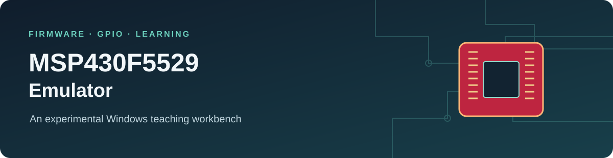
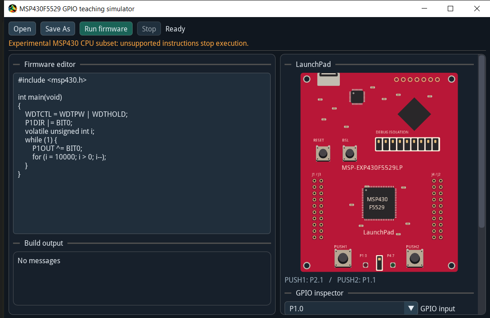
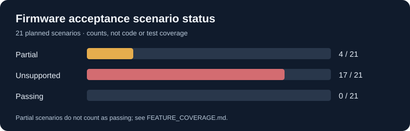

<div align="center">



**Write firmware. Explore GPIO. Learn by experimenting.**

[](#quick-start-windows)
[](FEATURE_COVERAGE.md)
[](LICENSE)

[Quick start](#quick-start-windows) · [Features](#what-you-can-explore) · [Coverage](#feature-status) · [Architecture](docs/ARCHITECTURE.md) · [Contributing](CONTRIBUTING.md)

</div>

A Windows desktop workbench for exploring simple MSP430F5529 C firmware, GPIO, LEDs, and buttons. It compiles firmware with TI's MSP430 GCC and executes it on an **experimental, incomplete CPU emulator**. It is a teaching tool, not a substitute for testing on hardware.



*The workbench at startup with the built-in blink example. The board illustration is schematic.*

## How it works

1. **Write or open C firmware** in the built-in editor.
2. **Compile and run** it with the MSP430 cross-compiler and experimental CPU emulator.
3. **Interact with the board** using the illustrated buttons and observe the LEDs.
4. **Inspect GPIO** or override input levels while exploring program behavior.

> **Safety:** Run only trusted source. Firmware execution is not a security boundary. The separate legacy Tkinter simulator compiles and executes native host code without a sandbox.

## What you can explore

| Workbench | Current behavior |
| --- | --- |
| Firmware editor | Edit C, open or save files, and inspect build output. |
| Board and GPIO | Approximate P1, P2, and P4 state; active-low S1 (P2.1) and S2 (P1.1); input overrides. |
| CPU execution | A limited MSP430 instruction subset, with optional native instruction batching and a Python fallback. |
| Multiplier | Partial, immediate unsigned 16-bit word multiplication. |
| Examples | Built-in blink, [alternating LEDs](examples/blink_2hz.c), and [button toggle](examples/button_toggle.c). |

Try the button exercise: open `examples/button_toggle.c`, click **Run firmware**, then press S1 to toggle the red P1.0 LED. This example polls the input; it is not an interrupt demonstration.

## Quick start (Windows)

You need Python with Tkinter and pip, a graphical desktop, and TI's Windows MSP430 GCC toolchain and device support files. The compiler and support files are **not included** in a fresh checkout. Windows with Python 3.14.2 and `imgui-bundle` 1.93.0 is the environment exercised here.

1. Install the Python dependency from the repository root:

   ```cmd
   python -m pip install -r requirements.txt
   ```

2. Configure the separately obtained toolchain and support files at the paths described in the **[Windows setup guide](docs/SETUP.md)**. This step is required before running firmware.
3. Start the workbench:

   ```cmd
   python simulator_imgui.py
   ```

   Or double-click `run.bat`. Click **Run firmware** to build the built-in example; if it succeeds, the P1.0 LED should blink. The setup guide also covers junctions, optional acceleration, and troubleshooting.

## Feature status



The chart summarizes the [acceptance baseline](FEATURE_COVERAGE.md): **4 partial**, **17 unsupported**, and **0 passing** scenarios. Partial scenarios do not count as passing; these are scenario counts, not code coverage or test coverage. The proposed 80% target is not yet achieved.

### Important limitations

- The CPU is not a complete MSP430X implementation. Unsupported instructions stop execution; some unsupported hardware writes may instead be stored without hardware effects.
- GPIO and buttons are approximated in batches. Floating inputs default low unless a pull resistor or override is selected; electrical contention is not modeled.
- The physical device memory map, watchdog, clock control, interrupts, timers, serial, ADC, USB, low-power modes, and most peripherals are not implemented.
- Cycle counts and adjustable MCLK pacing are experimental. The default assumed MCLK is 1,048,576 Hz; actual speed varies. Do not rely on timing, frequency, power, or hardware correctness.

See the [full feature table](FEATURE_COVERAGE.md) for the status of individual scenarios.

## Under the hood

The GUI compiles source into ELF, loads it into the CPU, and runs instruction batches on a worker while synchronizing GPIO state with the board model. The [architecture guide](docs/ARCHITECTURE.md) includes a source-linked diagram and describes the legacy host-C path.

| Path | Purpose |
| --- | --- |
| `simulator_imgui.py`, `board_ui.py` | Workbench, firmware runner, and board drawing. |
| `msp430_cpu.py`, `msp430_memory.py`, `msp430_multiplier.py` | Experimental CPU, memory dispatch, and partial multiplier. |
| `cpu_batch.py`, `cpu_batch.c` | Optional native batching and Python fallback. |
| `examples/`, `tests/` | Example firmware and automated tests with fixtures. |

## Development and testing

From the repository root, run:

```cmd
python -m unittest discover -v
```

The full suite needs the configured MSP430 toolchain and support files, host `gcc`, the Python dependency, and a graphical desktop. Some native-batch tests skip when the backend is unavailable. For a smaller compiler- and GUI-independent check:

```cmd
python -m unittest -v tests.test_memory tests.test_multiplier
```

`python benchmark_cpu.py` optionally compares execution modes and blink intervals; it requires the firmware toolchain and native backend. Results are machine-dependent and do not establish hardware timing accuracy. See [contributing](CONTRIBUTING.md) and [setup](docs/SETUP.md) for details.

## References and license

The implementation refers to TI's MSP430x5xx/x6xx family guide (SLAU208Q), MSP430F5529 device datasheet (SLAS590P), and TI MSP430 GCC device support files. Local reference copies and downloaded toolchains are ignored by Git and are not distributed here.

This project is **source-available**, not open source under the Open Source Definition. Its custom [license](LICENSE) permits noncommercial use and requires source code to be provided to recipients of modified versions; commercial use requires prior permission from the relevant copyright holders. Third-party components retain their own terms.
