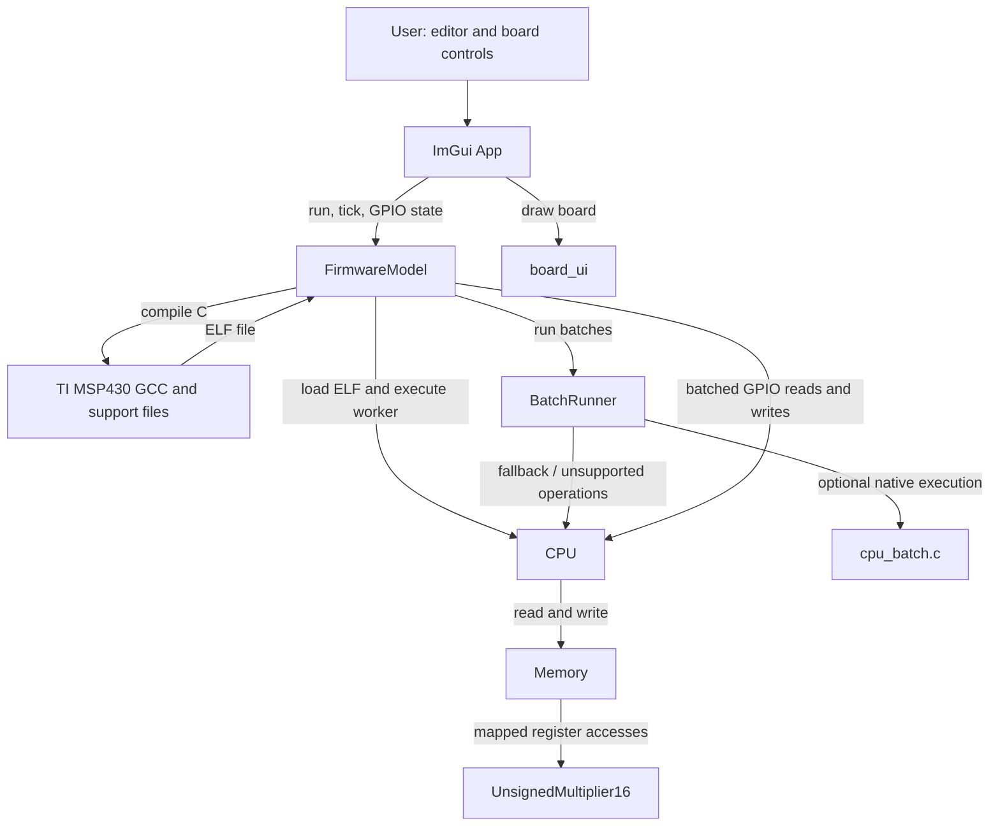

# Architecture

This diagram describes the **firmware-mode** path, not the separate legacy host-C simulator. Arrows are source-supported relationships and possible execution paths, not a claim that every path runs for every program.

**Text alternative:** The user interacts with the ImGui application, which uses the firmware model and board renderer. The model invokes the cross-compiler, loads the resulting ELF into the CPU, and runs a worker using the batch runner. CPU accesses go through memory, which dispatches mapped multiplier accesses. GPIO state is exchanged between the worker and the UI model in batches. The batch runner may use a native interpreter or the Python CPU.

| Relationship | Source evidence |
| --- | --- |
| Application creates `FirmwareModel`, renders the board, calls `run` and `tick` | [simulator_imgui.py](../simulator_imgui.py) (`App`), [board_ui.py](../board_ui.py) (`draw_board`) |
| Firmware model invokes the compiler, loads the ELF, starts and stops its worker, and transfers GPIO state | [simulator_imgui.py](../simulator_imgui.py) (`FirmwareModel`) |
| Batch runner optionally builds/loads native code and falls back to `CPU.step` | [cpu_batch.py](../cpu_batch.py) (`backend`, `BatchRunner`), [cpu_batch.c](../cpu_batch.c) (`run_batch`) |
| CPU loads ELF segments and accesses `Memory`; it registers the multiplier | [msp430_cpu.py](../msp430_cpu.py) (`CPU`) |
| Memory dispatches mapped accesses to the partial multiplier | [msp430_memory.py](../msp430_memory.py) (`Memory`), [msp430_multiplier.py](../msp430_multiplier.py) (`UnsignedMultiplier16`) |

## Boundaries and constraints

`Memory` provides RAM-like storage for unmapped locations, rather than enforcing the physical device memory map. The multiplier models only immediate unsigned 16-bit word multiplication. The worker samples GPIO between batches and paces execution based on an assumed clock; it does not simulate clock hardware or guarantee real-time behavior. [Feature coverage](../FEATURE_COVERAGE.md) distinguishes partial and unsupported device scenarios.

The older [simulator.py](../simulator.py) uses a Tkinter interface and compiles and runs native host C. The ImGui module also retains a host-C `Model`, but `App` selects `FirmwareModel`. Native host programs are not sandboxed; neither mode should be used for untrusted source.
